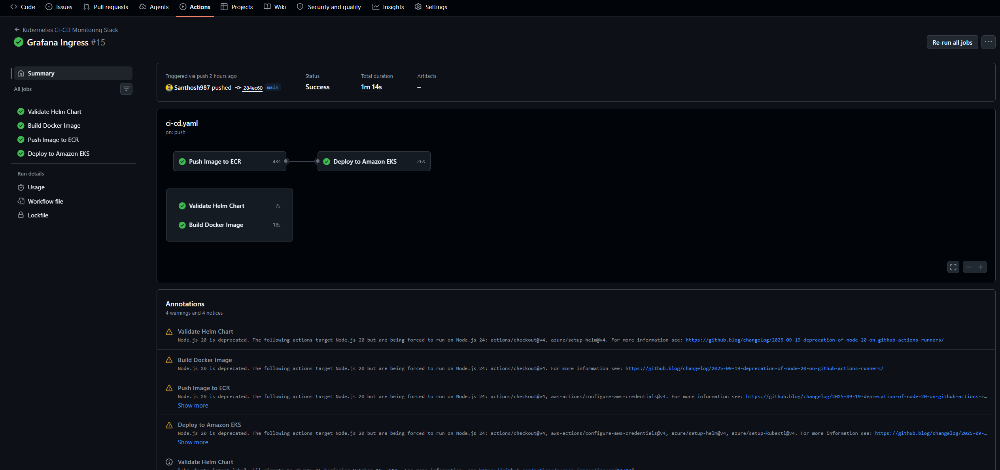
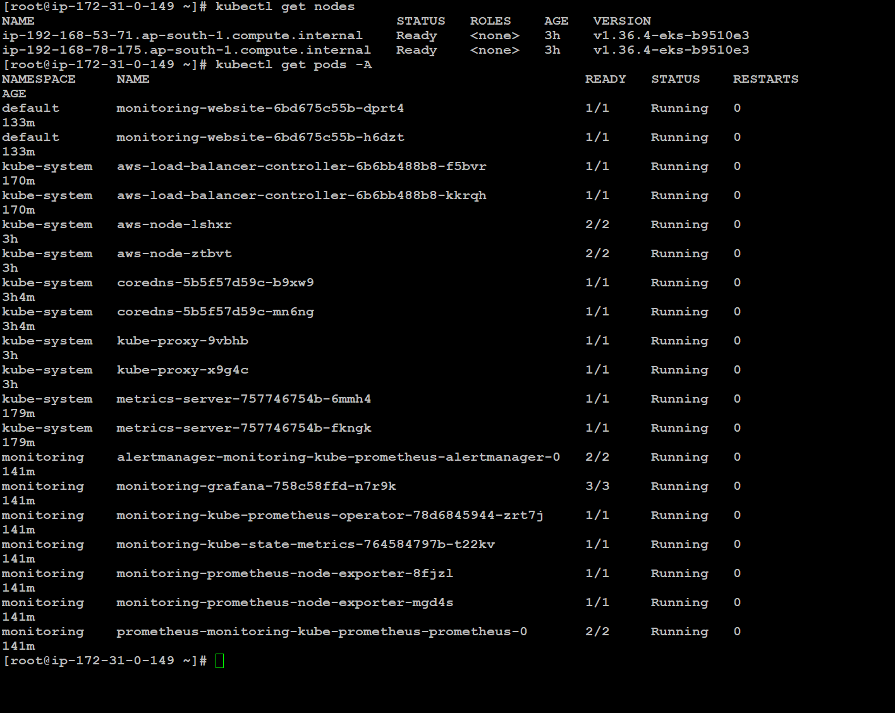
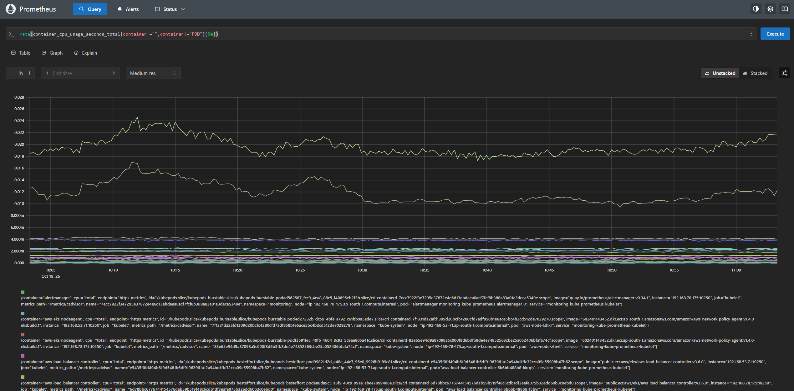
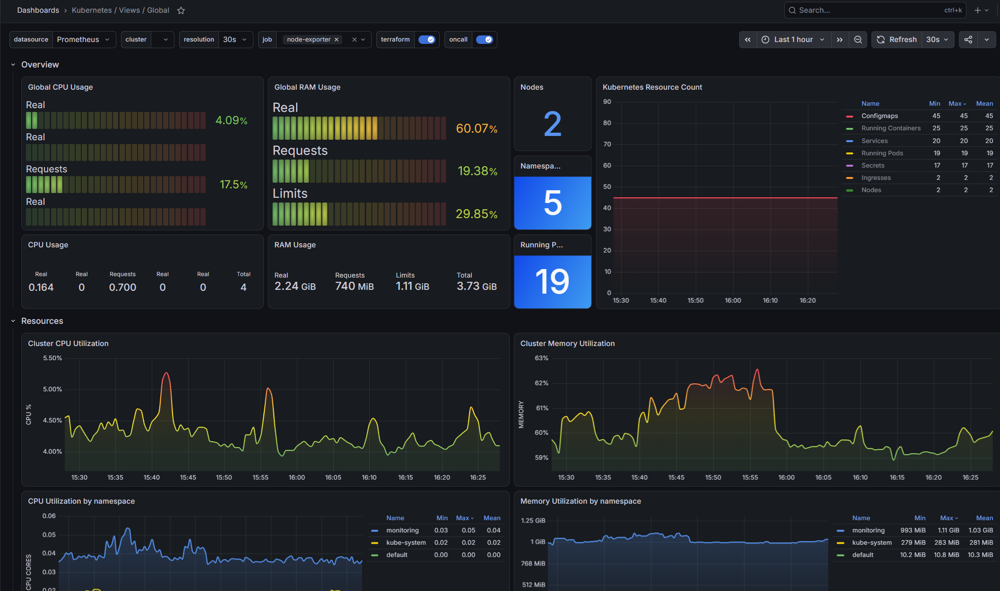
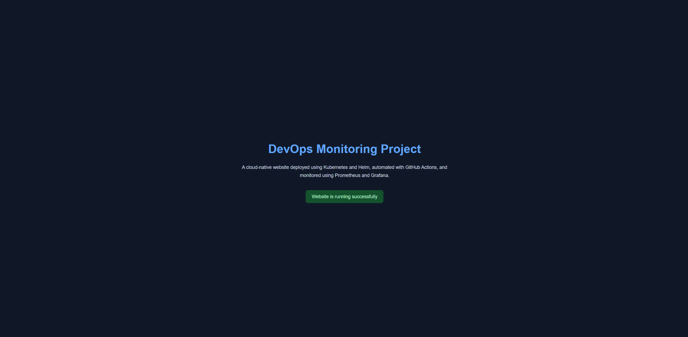

# Kubernetes CI/CD and Monitoring Stack using GitHub Actions, Docker, Amazon ECR & Amazon EKS

A hands-on DevOps project where I built a CI/CD pipeline using GitHub Actions, Docker, Amazon ECR, and Amazon EKS, along with Prometheus and Grafana for Kubernetes monitoring.

The pipeline validates the Helm chart, builds and pushes the Docker image to Amazon ECR, and deploys the application to Amazon EKS. Prometheus and Grafana are used to monitor Kubernetes resources and visualize cluster metrics.

## Technologies

- AWS
- GitHub
- GitHub Actions
- GitHub OIDC
- Docker
- Kubernetes
- Amazon ECR
- Amazon EKS
- AWS IAM
- AWS Application Load Balancer
- AWS Load Balancer Controller
- Helm
- Prometheus
- Grafana
- Linux

## Project Overview

The project consists of a containerized website deployed on Amazon EKS.

GitHub Actions is responsible for automating the CI/CD workflow. AWS IAM and GitHub OIDC are used to authenticate the workflow with AWS.

The pipeline performs the following:

- Validates the Helm chart
- Builds a Docker image for the website
- Authenticates to AWS using GitHub OIDC
- Pushes the Docker image to Amazon ECR
- Deploys the application to Amazon EKS
- Uses Kubernetes resources to run and expose the application
- Uses Prometheus to query Kubernetes metrics
- Uses Grafana to visualize monitoring data

## CI/CD Pipeline

The GitHub Actions workflow is maintained in:

`.github/workflows/ci-cd.yaml`

The pipeline follows these steps:

1. Code is pushed to the GitHub repository.
2. GitHub Actions starts the workflow.
3. The Helm chart is validated.
4. Docker builds the website image.
5. GitHub Actions authenticates to AWS using an IAM role and OIDC.
6. The Docker image is pushed to Amazon ECR.
7. The application is deployed to Amazon EKS.
8. The deployment and Kubernetes resources are verified.

Using OIDC allows GitHub Actions to authenticate to AWS without storing long-lived AWS access keys as GitHub secrets.

## AWS Configuration

The EKS cluster uses managed worker nodes.

GitHub Actions accesses AWS through an IAM role configured for GitHub OIDC authentication.

The AWS infrastructure was created for this project and has since been deleted to avoid ongoing charges.

## Kubernetes Deployment

The website is deployed to Amazon EKS using Kubernetes resources and Helm.

### Deployment

A Kubernetes Deployment manages the website pods.

### Service

A ClusterIP Service provides internal access to the application.

### Ingress

Kubernetes Ingress resources route external traffic through an AWS Application Load Balancer.

The website and Grafana dashboard were exposed through the same ALB using separate paths.

## Prometheus Monitoring

Prometheus was installed using the `kube-prometheus-stack` Helm chart.

I used Prometheus to inspect monitored targets, Kubernetes pod information, pod readiness, CPU usage, and memory consumption.

### Prometheus Queries

**Check monitored targets**

```promql
up
```

**Get Kubernetes pod information**

```promql
kube_pod_info
```

**Check ready pods**

```promql
kube_pod_status_ready{condition="true"}
```

**Check container CPU usage**

```promql
rate(container_cpu_usage_seconds_total{container!="",container!="POD"}[5m])
```

**Check container memory usage**

```promql
container_memory_working_set_bytes{container!="",container!="POD"}
```

These queries helped me understand how Prometheus collects and exposes Kubernetes metrics.

## Grafana Dashboard

Grafana was configured to use Prometheus as its data source.

I imported a Kubernetes monitoring dashboard and explored CPU usage, memory usage, pod information, and other workload metrics.

Grafana provided a visual way to inspect the cluster metrics collected by Prometheus.

## AWS Load Balancer

The AWS Load Balancer Controller was used to manage the Application Load Balancer through Kubernetes Ingress resources.

The ALB exposed:

- The website at the root path `/`
- Grafana under the `/grafana/` path

This helped me understand how Kubernetes Ingress integrates with AWS load balancing.

## Repository Structure

```text
kubernetes-cicd-monitoring-stack/
│
├── .github/
│   └── workflows/
│       └── ci-cd.yaml
│
├── website/
│   └── index.html
│
├── website-chart/
│   ├── Chart.yaml
│   ├── values.yaml
│   └── templates/
│
├── Dockerfile
├── monitoring-values.yaml
├── grafana-ingress.yaml
├── screenshots/
└── README.md
```

## Project Screenshots

### GitHub Actions Pipeline



### Amazon EKS Cluster



### Prometheus Metrics



### Grafana Dashboard



### Deployed Website




## Key DevOps Concepts Demonstrated

- CI/CD automation using GitHub Actions
- Docker image building and Amazon ECR
- GitHub OIDC authentication with AWS IAM
- Kubernetes Deployments and Services
- Helm chart validation and application deployment
- Amazon EKS cluster management
- AWS Application Load Balancer integration
- Kubernetes Ingress configuration
- Prometheus metrics and PromQL queries
- Grafana dashboards and monitoring
- AWS resource cleanup and cost awareness

## What I Learned

This project helped me understand how GitHub Actions, Docker, Amazon ECR, Amazon EKS, and Helm work together in a CI/CD workflow.

I also gained hands-on experience with GitHub OIDC authentication, Kubernetes Ingress, AWS load balancing, Prometheus queries, Grafana dashboards, and troubleshooting Kubernetes workloads.

## Project Status

The application and monitoring stack were deployed and tested during the project.

The AWS infrastructure has since been deleted to avoid ongoing charges. Therefore, the live website and Grafana dashboard are no longer accessible.

The source code and screenshots are retained in GitHub for reference.

## Future Improvements

- Terraform-based infrastructure provisioning
- Automated monitoring alerts
- Improved CI/CD deployment validation
- Argo CD and GitOps integration
- HTTPS configuration
- Additional Grafana dashboards

## Author

**Santhosh Subramanian V**

- GitHub: [Santhosh987](https://github.com/Santhosh987)
- LinkedIn: [Santhosh Subramanian V](https://www.linkedin.com/in/santhosh-subramanian-v/)
